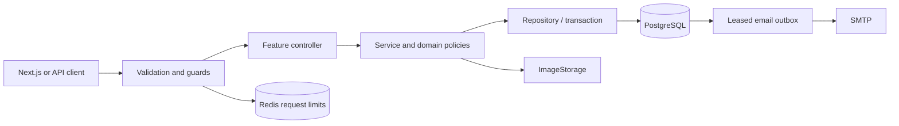

# Architecture

The repository is an npm workspace containing one backend application at `apps/api`. The current delivery is a modular NestJS REST API. A Next.js frontend can consume the versioned API without depending on Prisma or backend internals.

## Runtime and boundaries

- Node.js 24, NestJS 12 and strict TypeScript. The application compiles to CommonJS and runs on Node 24.
- PostgreSQL 17 is the source of truth. Prisma 7 uses `@prisma/adapter-pg`; the connection pool is bounded to ten connections per API process.
- Redis 7 holds distributed request limits. It is required infrastructure; protected requests fail closed when its limiter is unavailable.
- SMTP delivers account email from a PostgreSQL outbox. Mailpit is the local SMTP inbox.
- The image storage port has a local filesystem implementation. Images are persisted outside the container image.



Controllers translate HTTP input into DTOs. Services apply ownership rules and business transitions. Repository methods centralize projections, queries and transactional access. Pure policy functions handle range validation, state transitions and calculations. Dependencies are injected; `ImageStorage` is an explicit replaceable interface. Some compact administrative services use `PrismaService` directly when a separate repository would only forward a single operation.

## Modules

| Module                                 | Responsibility                                                                                           |
| -------------------------------------- | -------------------------------------------------------------------------------------------------------- |
| `auth`, `mail`                         | Customer registration, password hashing, sessions, single-use tokens, cookie/CSRF policy and SMTP outbox |
| `users`                                | Own profile, administrative account access changes and session revocation                                |
| `catalog`                              | Areas, amenities, developers, public agent profiles and autocomplete                                     |
| `listings`                             | Property discovery, filters, related listings, staff inventory and moderation                            |
| `projects`                             | Off-plan discovery, project administration, payment plans and floor plans                                |
| `content`                              | Published EN/AR guides, articles and area content                                                        |
| `leads`                                | Public contact intake and assigned staff follow-up                                                       |
| `workspace`                            | Account-owned favorites and saved searches                                                               |
| `media`                                | Bounded raster image decoding, re-encoding, ownership and authorized public serving                      |
| `calculators`                          | Pure mortgage and rental-yield estimates                                                                 |
| `audit`, `database`, `infra`, `health` | Shared persistence, minimal audit events, Redis and health endpoints                                     |

## Representation and publication

Text has explicit `En` and `Ar` fields. The frontend selects the language and owns RTL presentation. Monetary inventory values are PostgreSQL decimals in AED, serialized as strings. Canonical property area is square metres; public listing responses additionally calculate square feet and price per square metre. Dates use ISO 8601; a viewing request must include a timezone.

Listing and project states are `DRAFT`, `IN_REVIEW`, `PUBLISHED` and `ARCHIVED`. Staff submit inventory; publication is administrative. A published listing is public only while its area is active and its assigned user is active, verified and has a public agent profile. An associated project must also be published and have active area/developer records. These predicates are reused in listing discovery, related results, favorites, lead targets and public image access. Public projections explicitly select display fields, excluding account credentials, private email fields, internal notes and storage keys.

Publishing validates the stored business facts, active references and required publication fields. Administrative edits and transitions use a `version` field: a stale client receives a conflict instead of silently overwriting a more recent change. Permit fields are supplied by staff; the API does not independently verify permits with an external authority.

## Transactions and concurrency

- Account credential rows coordinate login, session refresh, password changes and token consumption. Refresh tokens are single-use; replay revokes the refresh family and commits that revocation before returning an error.
- Inventory, project and lead changes take row locks before enforcing ownership and transitions.
- Favorite and saved-search insertion locks the user row before checking quotas, preventing concurrent requests from exceeding account limits.
- Administrative role changes use a transaction-scoped advisory lock so concurrent demotions cannot remove the final active verified administrator.
- The SMTP outbox is written in the same transaction as account tokens. Workers claim short leases and deliver at least once, with bounded retries. A crash after SMTP acceptance can produce duplicate delivery; email token consumption remains single-use. Recipient/body fields are cleared after successful delivery, expiration or exhausted retries.
- Audit events are written alongside sensitive database changes and contain identifiers, action names and minimal non-contact metadata.

## Storage

The default `UPLOAD_DIR` is relative to the API working directory. The production image sets `/app/apps/api/uploads`, matching Compose's `media_data` volume. Only static JPEG, PNG and WebP input is accepted; the decoder checks format, limits pixels and re-encodes to WebP with a random internal filename. Original client filenames are never storage paths.

An image URL becomes public only when attached to a currently public listing, project, agent or content record. Detached/draft media is not served through the public route. A separate authenticated staff preview route enforces owner/admin/assigned-reference access. Used media must be detached before deletion. Upload and database insertion include compensation if metadata persistence fails; durable cross-system reconciliation and orphan cleanup remain operator tasks after a process/storage failure.

For multiple API replicas, replace `LocalImageStorage` with shared object storage or provide a shared writable filesystem. Independent container disks cannot serve one another's uploaded files. Database and media backups must be coordinated and restore-tested.

## Configuration and operations

`src/config/environment.ts` validates configuration at startup. The checked-in `.env.example` contains placeholders; `npm run setup:local` creates random local secrets. Production enforces secure cookies, HTTPS frontend/origins, disabled Swagger and TLS/STARTTLS SMTP. Set `TRUST_PROXY_HOPS` to the actual trusted proxy count; the default is zero. Rate limiting uses the resolved client IP, so proxy configuration must match deployment topology.

| Environment setting                                                            | Purpose / default                                                                                                  |
| ------------------------------------------------------------------------------ | ------------------------------------------------------------------------------------------------------------------ |
| `DATABASE_URL`, `REDIS_URL`                                                    | Required PostgreSQL and Redis connections; percent-encode special characters in URL credentials                    |
| `JWT_SECRET`, `JWT_ISSUER`, `JWT_AUDIENCE`                                     | Signing key and token boundary; issuer/audience default to `uae-real-estate-api` / `uae-real-estate-web`           |
| `ACCESS_TOKEN_TTL_SECONDS`, `REFRESH_TOKEN_TTL_DAYS`                           | Defaults 900 seconds / 30 days, both bounded by startup validation                                                 |
| `CORS_ORIGINS`, `FRONTEND_URL`                                                 | Exact comma-separated browser origins; base URL for account-email links                                            |
| `COOKIE_SECURE`, `TRUST_PROXY_HOPS`                                            | Secure-cookie policy and trusted proxy count                                                                       |
| `RATE_LIMIT_NAMESPACE`                                                         | Shared prefix for one deployment's replicas; default `estate:rate`; use distinct prefixes for isolated deployments |
| `PORT`, `HOST`                                                                 | API listener; default 4000 / `127.0.0.1`; containers set `0.0.0.0`                                                 |
| `SWAGGER_ENABLED`                                                              | Interactive docs; disabled by default and required off in production                                               |
| `UPLOAD_DIR`, `MAX_UPLOAD_BYTES`                                               | Persistent media directory and input byte cap; default `uploads` / 5 MiB                                           |
| `SMTP_HOST`, `SMTP_PORT`, `SMTP_SECURE`, `SMTP_FROM`, `SMTP_USER`, `SMTP_PASS` | SMTP transport and optional authentication                                                                         |
| `POSTGRES_PASSWORD`, `POSTGRES_PORT`, `REDIS_PASSWORD`, `REDIS_PORT`           | Local Compose settings; keep URL credentials/ports consistent with them                                            |
| `ADMIN_EMAIL`, `ADMIN_PASSWORD`, `ADMIN_FIRST_NAME`, `ADMIN_LAST_NAME`         | Operator CLI provisioning input; not public registration input                                                     |
| `SEED_DEMO`                                                                    | Explicit `true` required by the development-only fixture seed                                                      |

`MAILPIT_URL` is used by integration tests to inspect the local test inbox; the application itself sends through SMTP. Keep all API replicas in the same deployment on the same rate-limit namespace so their limits coordinate.

The default API origin is `http://localhost:4000`; all resource routes are below `/api/v1`. `/health/live` checks the process and `/health/ready` checks PostgreSQL and Redis. The runtime process handles shutdown hooks and closes database, Redis and SMTP connections. HTTP logs include a generated request ID, method, path, status and elapsed time; they omit bodies, headers and query strings.

The app does **not** automatically run schema migrations. Apply reviewed migrations once as a deployment job, then roll out the runtime image. Do not use `db:migrate` or `db push` against production.

```bash
# The build target retains Prisma CLI and tsx for an operator/deployment job.
docker build --target build -t uae-real-estate-tools:local .
docker run --rm --env-file /secure/api.env uae-real-estate-tools:local npm run db:deploy

# Run the lean runtime image with production configuration and durable media.
docker build --target runtime -t uae-real-estate-api:local .
docker run --rm --env-file /secure/api.env -p 127.0.0.1:4000:4000 \
  --mount source=estate_media,target=/app/apps/api/uploads \
  uae-real-estate-api:local
```

`/secure/api.env` is an operator-provided file outside the repository. Use database/Redis hostnames reachable from the container; `localhost` inside it is the container itself. Place the service behind an HTTPS reverse proxy. Runtime database credentials can be narrower than migration credentials. The `build` target contains source and tooling and is intended for trusted jobs; `runtime` contains compiled code and production dependencies and runs as the `node` user.

## Verification and delivery

`npm run check` runs lint, typechecking, unit tests and a build. `npm run test:e2e` exercises the built server with real PostgreSQL, Redis and Mailpit, creating and migrating an isolated database and selecting its own rate-limit namespace. It requires a database user with `CREATEDB` and must use dedicated test infrastructure. CI provisions PostgreSQL 17, Redis 7 and Mailpit, runs both check groups, exports the API contract and builds the Docker runtime image. Official GitHub actions are pinned to verified commit SHAs and receive read-only repository permissions.

The project does not yet contain the Next.js frontend, payment processing, an external permit-verification integration, a CRM integration or scheduled property-alert delivery. Saved searches are query persistence and on-demand execution. Mortgage/yield endpoints are input-based estimates, not finance approval or market forecasts.

### PostgreSQL driver compatibility

The pinned Prisma 7.10 / `pg` 8.23 combination can emit an upstream deprecation warning when Prisma loads nested relations inside a transaction. Current integration tests cover these paths; this is not treated as a failed query. Recheck adapter compatibility and the complete transaction suite before upgrading to `pg` 9 rather than suppressing or ignoring future driver behavior changes.
